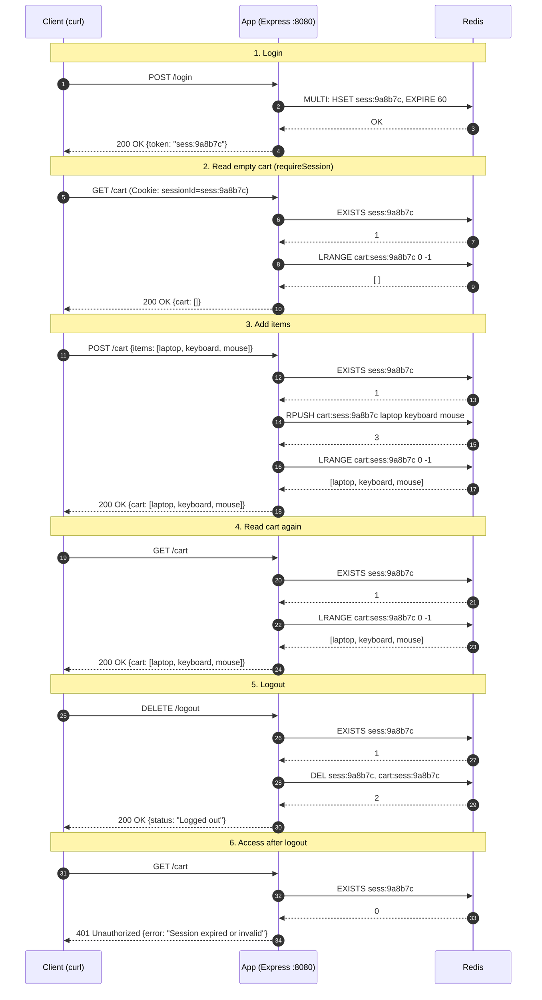

In this post, I will discuss session management with Redis in a rudimentary way.

Before you begin, please install the following.
- [redis-cli](https://redis.io/docs/latest/operate/oss_and_stack/install/archive/install-redis/install-redis-on-linux/)
- [node.js](https://nodejs.org/en/download)

I am going to create an app that will use a redis server to perform session management tasks. I want to focus on session management in this demo which is why we will assume that on login the auth takes place in the background somehow.

The reason why we use Redis for session management is because it is super-fast as it stores data in memory.

I am going to run everything locally.

# Code

Here is the app that we are going to use. You can download the code and instructions for running the code [here](https://github.com/muhammadalics/demos/tree/main/session-management).

```javascript {linenos=true}
import { createClient } from 'redis';
import express from 'express';

const PORT = 8080;
const SESSION_TTL_SECONDS = 60;

const app = express();
app.use(express.json());

const redisClient = createClient();
await redisClient.connect();

const cartKey = (sessionId) => `cart:${sessionId}`;
const getCart = (sessionId) => redisClient.lRange(cartKey(sessionId), 0, -1);

// Middleware: pull sessionId from the Cookie header and make sure it exists in Redis
async function requireSession(req, res, next) {
  const sessionId = (req.get('Cookie') ?? '')
    .split(';')
    .map((c) => c.trim())
    .find((c) => c.startsWith('sessionId='))
    ?.split('=')[1];

  if (!sessionId) {
    return res.status(401).send({ error: 'Unauthorized. Missing session token/cookie.' });
  }

  if (!(await redisClient.exists(sessionId))) {
    return res.status(401).send({ error: 'Session expired or invalid. Please log in again.' });
  }

  req.sessionId = sessionId;
  next();
}

// POST /login
app.post('/login', async (req, res) => {
  const sessionId = 'sess:9a8b7c';

  // Create the session and set its TTL
  await redisClient
    .multi()
    .hSet(sessionId, { uid: 'usr_1024', username: 'alice_dev' })
    .expire(sessionId, SESSION_TTL_SECONDS)
    .exec();

  res.send({ message: 'Logged in successfully!', token: sessionId });
});

// GET /cart
app.get('/cart', requireSession, async (req, res) => {
  res.send({ status: 'Authenticated', cart: await getCart(req.sessionId) });
});

// POST /cart - accepts a single item or an array of items
app.post('/cart', requireSession, async (req, res) => {
  const itemsToAdd = [].concat(req.body.items ?? []);

  if (itemsToAdd.length === 0) {
    return res.status(400).send({ error: "Bad Request. 'items' array or string is required." });
  }

  await redisClient.rPush(cartKey(req.sessionId), itemsToAdd);

  res.send({ message: 'Cart updated successfully', cart: await getCart(req.sessionId) });
});

// DELETE /logout - remove the session and cart
app.delete('/logout', requireSession, async (req, res) => {
  await redisClient.del([req.sessionId, cartKey(req.sessionId)]);
  res.send({ status: 'Logged out successfully. Session destroyed.' });
});

app.listen(PORT, () => console.log(`Server running on port ${PORT}`));
```

Before we run the above code lets briefly discuss what it does.

**Lines 7, 10 and 11**\
The app creates an Express server. It then creates a redis client and then the client connects to the redis server.

**Lines 17-34**\
This is the middleware. When any of the endpoints are called, `requireSession` will execute prior to the endpoint code execution.

**Lines 37-72**\
The code for the four app endpoints.
1. POST /login This endpoint simulates the app login. Here, we are not providing any user name and password and assuming that it has been taken care of. 
2. GET /cart Return the contents of the cart.
3. POST /cart Add items to the cart.
4. POST /logout Finish the session and cart.

# Demo

What I describe here is what happens in the video below.

I'm using [tmux](https://github.com/tmux/tmux/wiki) with three panes. The bottom pane is for the app. Middle is where we will run redis-cli and the top is where we will run our curl commands.

Lets start the the app with `node app.js` The app starts listening on port 8080 for incoming requests.

Lets start the redis cli with `redis-cli`. This starts a client that can talk to the redis server. Lets verify that the connection is working with `ping`. The reponse is pong which means that the connection is fine.

I am now going to run a series of curl commands. You can consider each command as client sending requests to the app. Also notice the middle pane where each interaction with the Redis server gets streamed.

The user logs into the app when client sends a POST request to the /login endpoint. The app creates a session id and sets the session expiry at 60 seconds. 

The client sends a GET request to see the contents of the cart. Nothing was put in the cart which is why it is empty.

The user then adds three items in the cart via POST /cart endpoint.

The user then queries the cart using GET /cart endpoint.

After that the client logs user out which destroys the cart and the session in Redis.

When the client attempts to call the POST /cart or GET cart endpoint, the server responds with a 401 status code.

We could choose to extend session everytime the user interacts with the app. Though it is not shown here, the reader could reset the session expiry in the GET /cart and POST /cart endpoints to achieve this.



# Curl Commands
This is the list of curl commands in order that we run in the demo. A few things to notice here.
- Each command uses the `-s` and `-S` flags so that the progress bar is not shown while still showing the errors.
- Except for the login command, we are sending cookie with each request.
- We are piping the output of each command to `jq` in order to make the output more legible.

```bash
curl -sS -X POST http://localhost:8080/login | jq .

curl -sS http://localhost:8080/cart --cookie "sessionId=sess:9a8b7c" | jq .

curl -sS -X POST http://localhost:8080/cart   --cookie "sessionId=sess:9a8b7c"   -H "Content-Type: application/json"   -d '{"items":["laptop","keyboard","mouse"]}' | jq .

curl -sS http://localhost:8080/cart --cookie "sessionId=sess:9a8b7c" | jq .

curl -sS -X DELETE http://localhost:8080/logout --cookie "sessionId=sess:9a8b7c" | jq .

curl -sS http://localhost:8080/cart --cookie "sessionId=sess:9a8b7c" | jq .

```

# Sequence Diagram
This sequence diagram goes into the flow of requests between client and app and between the app and Redis.
